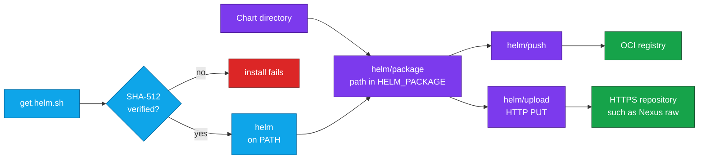

<div align="center">


# Helm Orb for CircleCI

### Package your Helm charts and ship them to your registry, straight from CircleCI.

Install a checksum-verified [Helm](https://helm.sh), package your chart, and push it to an OCI registry<br>
or upload it to an HTTPS repository, in a few steps of CircleCI config.<br>
Strict SHA-512 verification by default · No `sudo` · Passwords never on the command line

[](https://circleci.com/gh/juburr/helm-orb)
[](https://circleci.com/developer/orbs/orb/juburr/helm-orb)
[](LICENSE)
[](https://discuss.circleci.com/c/ecosystem/orbs)


**[Quick Start](#-quick-start)** · **[Features](#-why-helm-orb)** · **[Recipes](#-recipes)** · **[Commands](#-commands)** · **[Upgrading](#-upgrading)** · **[Security](#-secure-by-design)** · **[Network Access](#-network-access)**

<sub>An unofficial, community-maintained orb. [Contributions are welcome!](#-contributing)</sub>

</div>

<br>

## ✨ Why helm-orb?

<table>
<tr>
<td width="33%" valign="top">
📦 <b>From chart to registry in one job</b><br><br>
<code>package</code> builds the <code>.tgz</code> and hands its path to later steps as <code>HELM_PACKAGE</code>. <code>registry_login</code>, <code>push</code> and <code>registry_logout</code> publish it. No file names to work out.
</td>
<td width="33%" valign="top">
⚓ <b>Helm 3 and Helm 4</b><br><br>
The checksum table covers Helm 3.0.0 through 4.3.0, and CI runs the publishing commands under Helm 3.22.0 and Helm 4. <code>plain_http</code> handles Helm 4's stricter registry rules. See <a href="#-helm-versions">Helm Versions</a>.
</td>
<td width="33%" valign="top">
🌐 <b>OCI registries or plain HTTPS</b><br><br>
<code>push</code> to an OCI registry such as GHCR or Docker Hub, or <code>upload</code> with an HTTP PUT to a repository such as a Nexus raw repository. A failed upload fails the step and shows you the response.
</td>
</tr>
<tr>
<td width="33%" valign="top">
🔐 <b>Verified installs, fail-closed by default</b><br><br>
By default, every Helm binary is checked against a SHA-512 table built into the orb, and versions it can't verify are refused, not run. <a href="#-checksum-verification">Opt-outs</a> are explicit.
</td>
<td width="33%" valign="top">
🔑 <b>Secrets stay off the command line</b><br><br>
Credential parameters name environment variables. Passwords reach Helm and curl on stdin, so they never show up in a process listing or the step log, even with xtrace on.
</td>
<td width="33%" valign="top">
🦾 <b>amd64 and arm64</b><br><br>
Picks the right Helm build for x86_64 executors and CircleCI Arm resource classes, cached per version and architecture.
</td>
</tr>
</table>

### 🧩 The Orb vs. a Hand-Rolled Script

| | Scripting Helm yourself | With the orb |
| --- | --- | --- |
| **Installing Helm** | Download the release from `get.helm.sh`, find and check its checksum, extract it, and put `helm` on the `PATH` | `helm/install` checks the binary against a built-in SHA-512 for amd64 and arm64, fails closed on unknown versions, caches the release, and adds `install_path` to the `PATH` when it isn't there |
| **Finding the packaged chart** | Work out the `.tgz` file name from `Chart.yaml` and the version, and pass it on to later steps | `package` and `locate_chart` export its absolute path, shell-quoted, as `HELM_PACKAGE` |
| **Registry login** | Pipe the password to `helm registry login --password-stdin`, and keep a traced step from printing it | `registry_login` reads the variables you name and does both |
| **Uploading to a raw repository** | `curl -u user:password` puts the credentials on the command line, and curl exits 0 when the server answers 401 or 500 | `upload` passes them on stdin, only over `https://`, and fails the step on any non-2xx response, printing the response |

## 🔄 How It Works



`helm/install` downloads Helm straight from `get.helm.sh`, the Helm project's download site, verifies the SHA-512 checksum of its `helm` binary in the default `strict` mode shown here, and puts it on `PATH`. See [Checksum Verification](#-checksum-verification) for the other modes. `helm/package` packages your chart directory and exports the `.tgz` file's path as `HELM_PACKAGE`. `helm/push` sends it to an OCI registry you logged in to with `helm/registry_login`, or `helm/upload` PUTs it to an HTTPS repository. When the chart was packaged in an earlier job, `helm/locate_chart` finds it and exports the same path.

## 🚀 Quick Start

Add the orb, install Helm, package your chart, push it. Copy this into `.circleci/config.yml`:

```yaml
version: 2.1

orbs:
  helm: juburr/helm-orb@0.8.0

jobs:
  publish_chart:
    docker:
      - image: cimg/base:current-22.04
    steps:
      - checkout
      - helm/install:
          version: "4.3.0"
      - helm/package:
          chart_dir: charts/myservice
          chart_version: 1.0.0
          app_version: 2.4.1
      # Reads the credentials from REGISTRY_USERNAME and REGISTRY_PASSWORD.
      - helm/registry_login:
          registry: ghcr.io
      - helm/push:
          chart: ${HELM_PACKAGE}
          remote: oci://ghcr.io/my-org/helm-charts
      - helm/registry_logout:
          registry: ghcr.io

workflows:
  publish:
    jobs:
      - publish_chart:
          context: registry-credentials
```

Swap in your chart directory, versions and registry, put `REGISTRY_USERNAME` and `REGISTRY_PASSWORD` in the `registry-credentials` context (for GHCR, your GitHub username and a token that can write packages), and push. Helm appends the chart's name to `remote` and tags it with the chart's version, so a chart named `myservice` is published as `ghcr.io/my-org/helm-charts/myservice:1.0.0`. `chart_version` and `app_version` expand environment variables, so they can come from your build. For a repository that takes an HTTP PUT instead of OCI, see [Recipes](#-recipes).

> [!TIP]
> Upgrading from `push_raw` or the `*_directory` parameters? The next release renames a command and several parameters. See [Upgrading](#-upgrading).

> [!IMPORTANT]
> The default Helm `version` has been Helm 4 since v0.7.0 of this orb. Pin `version` as shown, so Helm only changes when you decide to. See [Helm Versions](#-helm-versions) for what differs between Helm 3 and Helm 4.

## 🍳 Recipes

### Upload to a Nexus Raw Repository

`upload` sends the packaged chart with an HTTP PUT to any repository that accepts one, such as a Nexus raw repository. It reads the credentials from `HELM_REPO_USERNAME` and `HELM_REPO_PASSWORD` unless you name other variables:

```yaml
steps:
  - checkout
  - helm/install:
      version: "4.3.0"
  - helm/package:
      chart_dir: charts/myservice
      chart_version: 1.0.0
      app_version: 2.4.1
  # A url ending in "/" gets the chart's file name appended.
  - helm/upload:
      chart: ${HELM_PACKAGE}
      url: https://nexus.example.com/repository/my-raw-repo/charts/
      username: HELM_REPO_USERNAME
      password: HELM_REPO_PASSWORD
```

The URL must start with `https://`, since the credentials travel in a request header. The step fails, and prints the response code and body, unless the server answers with a 2xx status.

### Push a Chart Packaged in an Earlier Job

Package once, then find the chart in a later job with `locate_chart`, which exports its path the same way `package` does:

```yaml
jobs:
  package_chart:
    docker:
      - image: cimg/base:current-22.04
    steps:
      - checkout
      - helm/install:
          version: "4.3.0"
      - helm/package:
          chart_dir: charts/myservice
          chart_version: 1.0.0
          app_version: 2.4.1
          output_dir: /home/circleci/charts
      - persist_to_workspace:
          root: /home/circleci
          paths:
            - charts

  push_chart:
    docker:
      - image: cimg/base:current-22.04
    steps:
      - attach_workspace:
          at: /home/circleci
      - helm/install:
          version: "4.3.0"
      - helm/locate_chart:
          search_dir: /home/circleci/charts
          chart_name: myservice
          chart_version: 1.0.0
      - helm/registry_login:
          registry: ghcr.io
      - helm/push:
          chart: ${HELM_PACKAGE}
          remote: oci://ghcr.io/my-org/helm-charts
      - helm/registry_logout:
          registry: ghcr.io

workflows:
  publish:
    jobs:
      - package_chart
      - push_chart:
          context: registry-credentials
          requires:
            - package_chart
```

`locate_chart` searches only `search_dir` itself, not its subdirectories, and matches `chart_name` and `chart_version` anywhere in the file name, ignoring case. Set both when the directory can hold more than one chart.

### Push to a Registry Without TLS

Helm 4 never falls back to plain HTTP, so a registry without TLS, such as an internal test registry, needs `plain_http: true` on both `registry_login` and `push`:

```yaml
steps:
  - helm/registry_login:
      registry: registry.internal:5000
      plain_http: true
  - helm/push:
      chart: ${HELM_PACKAGE}
      remote: oci://registry.internal:5000/charts
      plain_http: true
  - helm/registry_logout:
      registry: registry.internal:5000
```

CI runs these steps against a local `registry:2` service container under Helm 3.22.0 and the default Helm 4 release. `plain_http` needs Helm 3.18.0 or later on `registry_login`, and 3.13.0 or later on `push`.

## 🔢 Helm Versions

v0.7.0 of this orb changed the default Helm `version` from 3.18.6 to 4.3.0 (Helm 4). If you upgraded the orb without setting `version` on `install`, your pipeline now runs Helm 4. Pin the Helm version you need, and pin the orb to an exact release so that future default changes only reach you when you choose to upgrade:

```yaml
orbs:
  helm: juburr/helm-orb@0.8.0
jobs:
  publish-chart:
    docker:
      - image: cimg/base:current-22.04
    steps:
      - helm/install:
          version: "3.22.0" # or "4.3.0"
```

Both major versions are tested in this orb's CI: `install`, `package`, `locate_chart`, `registry_login`, `push` and `registry_logout` run against Helm 3.22.0 and the default Helm 4 release. Differences between Helm 3 and Helm 4 that affect this orb:

- `registry_login`: Helm 4 accepts a hostname only (for example `ghcr.io`, not `https://ghcr.io`), and it no longer falls back to plain HTTP. Set `plain_http: true` for registries without TLS (available from orb 0.8.0).
- `push`: Helm 3 and Helm 4 both need `plain_http: true` to push to a registry without TLS.

Helm 3 stopped receiving bug fixes on September 9, 2026 and receives security fixes until February 10, 2027 ([announcement](https://helm.sh/blog/helm-v3-end-of-life)).

## 🧰 Commands

### `helm/install`

Installs Helm for Linux on amd64 or arm64, matching the executor's CPU. In the default `strict` mode it verifies the SHA-512 checksum first and refuses versions it has no checksum for; see [Checksum Verification](#-checksum-verification) for the opt-outs. Run it before the orb's other commands. Needs bash 4 or newer on the executor.

| Parameter | Default | Description |
| --- | --- | --- |
| `version` | `4.3.0` | Helm release to install; a leading `v` is ignored. Pin it so Helm only changes when you decide to. Values that aren't a release version, such as `latest`, are rejected. |
| `install_path` | `$HOME/bin` | Absolute path of the directory to install into, writable without root. Created if needed, and added to `PATH` for later steps when it isn't already on it. A leading `~/` is expanded. |
| `verify_checksums` | `strict` | `strict`, `known_versions` or `false`. See [Checksum Verification](#-checksum-verification). |
| `caching` | `true` | Cache the verified release between jobs, keyed by version, CPU architecture and home directory. A cached release is verified again before it is installed. |

### `helm/package`

Packages a chart directory with `helm package`, stamping it with the chart and app versions you give, and exports the packaged chart's absolute path to later steps in the variable `package_env_var` names. Needs Helm on the `PATH`, so run `install` first.

| Parameter | Default | Description |
| --- | --- | --- |
| `chart_dir` | *required* | Path to the chart directory, the one that holds `Chart.yaml`. |
| `chart_version` | *required* | Version of the chart itself (Helm's `--version`). |
| `app_version` | *required* | Version of the application the chart deploys (Helm's `--app-version`). |
| `output_dir` | `.` | Directory to write the packaged chart (`.tgz` file) to. Created if it doesn't exist. |
| `package_env_var` | `HELM_PACKAGE` | *Name* of the environment variable to set, for later steps, to the packaged chart's absolute path. |

### `helm/locate_chart`

Finds a packaged chart (`.tgz` file) in a directory, such as one attached from a workspace, and exports its absolute path to later steps, as `package` does. The step fails when no file matches, and takes the first file it finds when several do. Doesn't need Helm.

| Parameter | Default | Description |
| --- | --- | --- |
| `chart_name` | *(empty)* | Only match files whose name contains this, ignoring case. |
| `chart_version` | *(empty)* | Only match files whose name contains this version, ignoring case. |
| `search_dir` | `.` | Directory to search. Subdirectories are not searched. |
| `package_env_var` | `HELM_PACKAGE` | *Name* of the environment variable to set, for later steps, to the chart's absolute path. |

### `helm/registry_login`

Logs Helm in to an OCI registry with `helm registry login`, so `push` can write to it. The password reaches Helm on stdin (`--password-stdin`), never on its command line, and the step turns xtrace off before it reads the credentials. Keep the credential variables in a context or your project settings.

| Parameter | Default | Description |
| --- | --- | --- |
| `registry` | *required* | Registry hostname to log in to, with an optional port, such as `ghcr.io` or `localhost:5000`. Pass the bare host, not the `oci://` URL that `push` takes as `remote`: Helm 4 rejects a URL scheme or repository path. |
| `username` | `REGISTRY_USERNAME` | *Name* of the environment variable holding the username. |
| `password` | `REGISTRY_PASSWORD` | *Name* of the environment variable holding the password or token. |
| `plain_http` | `false` | Log in over plain HTTP instead of HTTPS, for a registry without TLS such as a local test registry. Helm 4 requires this for HTTP registries, while Helm 3 falls back to HTTP without it. Needs Helm 3.18.0 or later. |

### `helm/push`

Pushes a packaged chart to an OCI registry with `helm push`. Helm appends the chart's name to `remote` and tags the chart with its version. Run `registry_login` first for a registry that needs credentials.

| Parameter | Default | Description |
| --- | --- | --- |
| `chart` | *required* | Path to the packaged chart (`.tgz` file), such as `${HELM_PACKAGE}`. |
| `remote` | *required* | OCI registry URL to push to, `oci://host[:port]/path`, which is Helm's `[remote]` argument (for example `oci://ghcr.io/organization/helm-charts`). |
| `plain_http` | `false` | Push over plain HTTP instead of HTTPS, for a registry without TLS such as a local test registry. Helm 3 and Helm 4 both require this for HTTP registries. Needs Helm 3.13.0 or later. |

### `helm/registry_logout`

Logs Helm out of a registry with `helm registry logout`, removing the credentials `registry_login` stored. Run it after the job's last `push`.

| Parameter | Default | Description |
| --- | --- | --- |
| `registry` | *required* | Registry hostname to log out from. Use the same value you passed to `registry_login`. |

### `helm/upload`

Uploads a packaged chart with an HTTP PUT, such as to a Nexus raw repository. The credentials reach curl on stdin, never its command line, and only over `https://`. curl ignores the runner's `.curlrc` and doesn't follow redirects. The step fails if either credential variable is unset or empty, and unless the server responds with a 2xx status, in which case it prints the response code and up to 4096 bytes of the body. Needs curl, not Helm.

| Parameter | Default | Description |
| --- | --- | --- |
| `chart` | *required* | Path to the packaged chart (`.tgz` file), such as `${HELM_PACKAGE}`. |
| `url` | *required* | `https://` URL to upload the chart to: either a directory URL ending in `/`, to which the chart's file name is appended, or the full URL of the file to create. Must start with `https://`, since the credentials are sent in a request header. |
| `username` | `HELM_REPO_USERNAME` | *Name* of the environment variable holding the username. |
| `password` | `HELM_REPO_PASSWORD` | *Name* of the environment variable holding the password or token. |

Environment variables are expanded in `install`'s `version` and `install_path`, `package`'s `chart_dir`, `chart_version`, `app_version` and `output_dir`, `locate_chart`'s `chart_name`, `chart_version` and `search_dir`, `registry_login`'s and `registry_logout`'s `registry`, `push`'s `chart` and `remote`, and `upload`'s `chart` and `url`.

## 📦 Upgrading

The next release renames a command and several parameters, to use Helm's own terms and the names the other juburr orbs use. Update your config as follows:

| Old | New |
| --- | --- |
| `push_raw` command | `upload` command |
| `push_raw.upload_path` | `upload.url` |
| `push_raw.username_env` (default `NEXUS_USER`) | `upload.username` (default `HELM_REPO_USERNAME`) |
| `push_raw.password_env` (default `NEXUS_PASSWORD`) | `upload.password` (default `HELM_REPO_PASSWORD`) |
| `package.chart_directory` | `package.chart_dir` |
| `package.output_directory` | `package.output_dir` |
| `package.env_output_package` | `package.package_env_var` |
| `locate_chart.env_output_package` | `locate_chart.package_env_var` |
| `locate_chart.search_directory` | `locate_chart.search_dir` |
| `push.registry` | `push.remote` |
| `registry_login.username_env` (default `GITHUB_USER`) | `registry_login.username` (default `REGISTRY_USERNAME`) |
| `registry_login.password_env` (default `GITHUB_TOKEN`) | `registry_login.password` (default `REGISTRY_PASSWORD`) |

If you relied on the old default credential variables, either rename those variables in your contexts or project settings, or pass their old names, for example `username: NEXUS_USER`.

Behavior changes:
- `upload` fails the step when the server responds with anything other than a 2xx status, and prints the response code and body. `push_raw` reported success on HTTP errors such as 401 or 500. The credentials now reach curl on stdin instead of its command line, and `upload` fails if either credential variable is unset or empty.
- `package` and `locate_chart` shell-quote the path they export through `BASH_ENV`, so paths containing spaces or other special characters reach later steps intact.
- Failure messages, such as `upload`'s "The upload failed: ...", now start with `ERROR:` and go to stderr. A step that searches a command's output for one must read stderr too.
- `install` verifies in `strict` mode by default (it was `known_versions`), so a Helm version without a checksum in the orb fails before anything is downloaded; see [Checksum Verification](#-checksum-verification). `install_path` defaults to `$HOME/bin` (it was `/home/circleci/bin`, the same directory on CircleCI's images), must be an absolute path, and is added to the `PATH` of later steps when needed. `version` must be a release version, a binary that can't run on the executor fails the install, and `install` needs bash 4 or newer.

## 🔒 Secure by Design

- **Least Privilege**: Installs to a user-owned directory by default, with no `sudo` usage anywhere in this orb.
- **Integrity**: SHA-512 checksum validation of the downloaded Helm binary, on by default and failing closed: a Helm version this orb has no checksum for is refused before anything is downloaded, and a binary that can't run on the executor never replaces an existing install. See [Checksum Verification](#-checksum-verification) for the `known_versions` and `false` opt-outs.
- **Provenance**: Installs directly from `get.helm.sh`, the download site of the [Helm project](https://helm.sh/). No third-party websites, domains, or proxies are used.
- **Confidentiality**: Credential parameters take the *names* of environment variables, never their values. `registry_login` passes the password to Helm on stdin and `upload` passes both credentials to curl on stdin, so they never appear on a command line, and both turn xtrace off first so a job that traces its steps doesn't print them. `upload` sends credentials over `https://` only. All secrets and environment variables are handled in accordance with CircleCI's [security recommendations](https://circleci.com/docs/security-recommendations/) and [best practices](https://circleci.com/docs/orbs-best-practices/).
- **Privacy**: No usage data of any kind is collected or shipped back to the orb developer.

> [!IMPORTANT]
> **Info for security teams:** see [Network Access](#-network-access) for the hosts to allow on locked-down or self-hosted runners.

## 💻 Supported Platforms

Linux executors on `x86_64` (amd64) and `aarch64`/`arm64` (arm64), including CircleCI [Arm resource classes](https://circleci.com/docs/using-arm/). The `install` command picks the Helm release asset for the architecture reported by `uname -m` and, in the default `strict` mode, verifies it against that architecture's SHA-512 checksum. Any other operating system or architecture fails the install rather than installing a binary that can't run. CI installs on `cimg/base` (Docker, amd64) and on an Arm machine executor.

`install` needs bash 4 or newer, `mktemp`, `tar`, `gzip`, and `curl` or `wget`, plus `sha512sum` when it verifies. CircleCI's `cimg` and machine images have all of them; on an image that lacks one, such as Red Hat UBI, install it in an earlier step (for example `microdnf install -y tar gzip`).

The download cache is keyed by Helm version, executor architecture and home directory, so amd64 and arm64 jobs never share a cached release. On executors whose `PATH` doesn't already include `install_path` (for example, machine executors), `install` adds it for later steps through `BASH_ENV`.

## 🔐 Checksum Verification

The `install` command checks the `helm` binary from the downloaded release against a SHA-512 lookup table built into the orb, with one entry per Helm version and architecture. The `verify_checksums` parameter controls what happens:

| Value | Version in the orb's table | Version not in the table |
| --- | --- | --- |
| `strict` (default) | ✅ Verified; install fails on mismatch | ⛔ Install fails before anything is downloaded |
| `known_versions` | ✅ Verified; install fails on mismatch | ⚠️ Installed **unverified**, with a warning |
| `false` | ⚠️ Not verified | ⚠️ Installed **unverified** |

The table covers Helm releases from 3.0.0 through 4.3.0, the default `version`. `src/scripts/install_hash.sh` prints a new entry only after checking the release archive against the SHA-256 checksum Helm publishes next to it on `get.helm.sh`. If you pin a Helm release newer than this orb, `strict` fails until the orb is upgraded. Upgrade the orb (or open a PR adding the checksum, generated with `src/scripts/install_hash.sh`) rather than opting out. `known_versions` and `false` remain available for cases where you accept running an unverified binary.

> [!WARNING]
> **Changed in the next release:** the default was previously `known_versions`, which installed unlisted versions without verification. Pipelines that pin a Helm version newer than the orb's table now fail until they upgrade the orb or set `verify_checksums: known_versions` explicitly.

## 🌐 Network Access

Hosts to allow (HTTPS, port 443) when running on a locked-down, self-hosted runner:

| Host | Needed by | Purpose |
| --- | --- | --- |
| `get.helm.sh` | `install` | Helm release download. This is the only host the orb's scripts contact on their own. Downloads are served directly from it, with no redirects to other hosts. |
| `circleci-tasks-prod.s3.us-east-1.amazonaws.com` | `install` with `caching: true` (the default), on CircleCI cloud with self-hosted runners | CircleCI's cache storage, used by the built-in `restore_cache` and `save_cache` steps (see the [runner FAQ](https://circleci.com/docs/guides/execution-runner/runner-faqs/#what-connectivity-is-required)). Set `caching: false` to avoid it. |

Hosts you configure, contacted only by the commands that take them:

| Host | Needed by | Purpose |
| --- | --- | --- |
| The registry: `registry_login`'s `registry`, or the host in `push`'s `remote` | `registry_login`, `push` | The OCI registry, plus any other host that registry directs Helm to, such as a token service it delegates authentication to (for example, Docker Hub uses `auth.docker.io`) or a separate upload endpoint named in its responses |
| The host in `upload`'s `url` | `upload` | The HTTP PUT upload |

A registry is reached on the port in the value you pass (443 by default), over plain HTTP when `plain_http` is set. `package`, `locate_chart` and `registry_logout` make no network requests. On a runner with no route to `get.helm.sh`, bake Helm into the executor image instead, after checking the `helm` binary's SHA-512 against the table in [`src/scripts/install.sh`](src/scripts/install.sh), and skip `install`: the other commands only need `helm` on the `PATH`.

## 🤝 Contributing

This is an unofficial, community-maintained orb, and contributions are welcome! Bug reports, feature ideas and pull requests all help.

- **Found a bug or have an idea?** [Open an issue](https://github.com/juburr/helm-orb/issues).
- **Need a newer Helm release?** Generate its checksums with `src/scripts/install_hash.sh -v <version>`, paste them into the `sha512sums` table in [`src/scripts/install.sh`](src/scripts/install.sh), and open a pull request. The script checks each release archive against the SHA-256 checksum Helm publishes next to it on `get.helm.sh` before it prints an entry, and needs `curl`, `sha256sum`, `sha512sum`, `tar` and `gzip`.
- **Before opening a pull request**, run the checks CI runs. The tests run offline; `upload_test.sh` needs `python3`, `openssl` and `curl`. `circleci orb validate` checks the packed orb against the CircleCI API, so it needs network access.

  ```bash
  yamllint .
  shellcheck src/scripts/*.sh tests/*.sh
  for t in tests/*_test.sh; do bash "$t" || break; done
  circleci orb pack src > orb.yml && circleci orb validate orb.yml
  ```

## 📜 License

[MIT](LICENSE) © 2024-2025 Justin Burr

<br>

<div align="center">
  
  <br>
  <sub>From <code>Chart.yaml</code> to registry in one job. If this orb helps your team, a ⭐ helps others find it.</sub>
  <br>
  <sub><a href="#helm-orb-for-circleci">Back to top ↑</a></sub>
</div>
